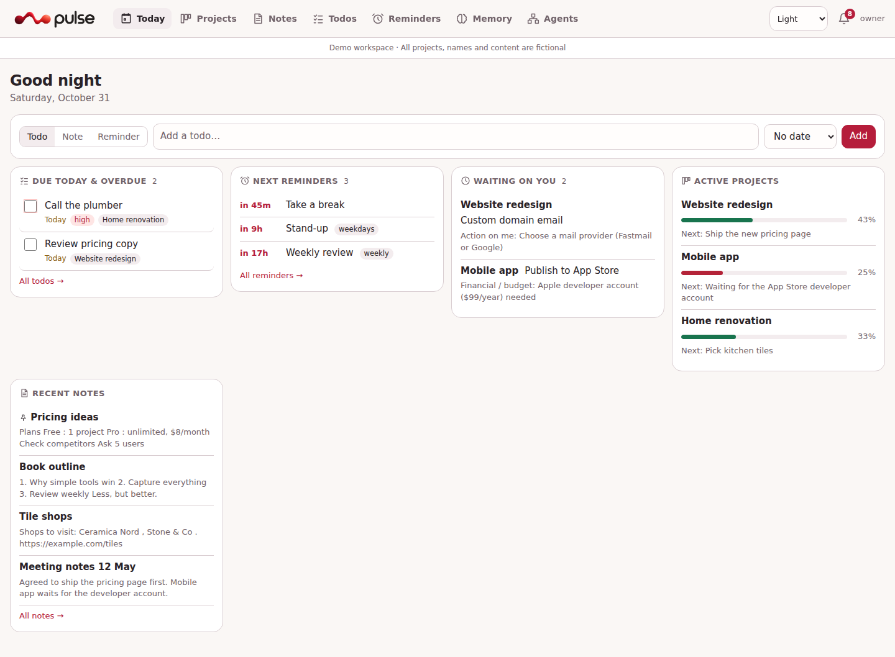
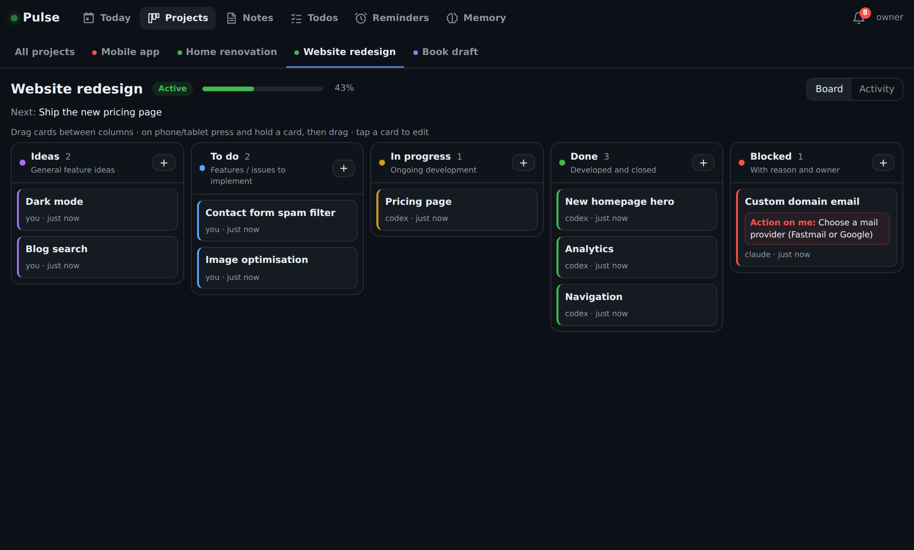
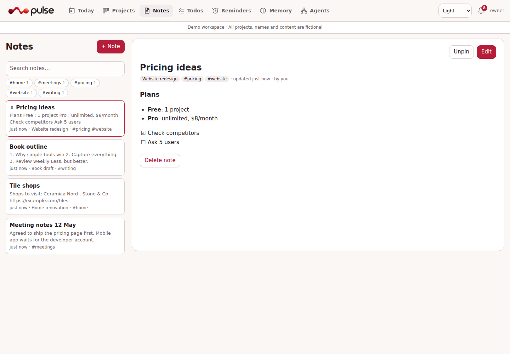
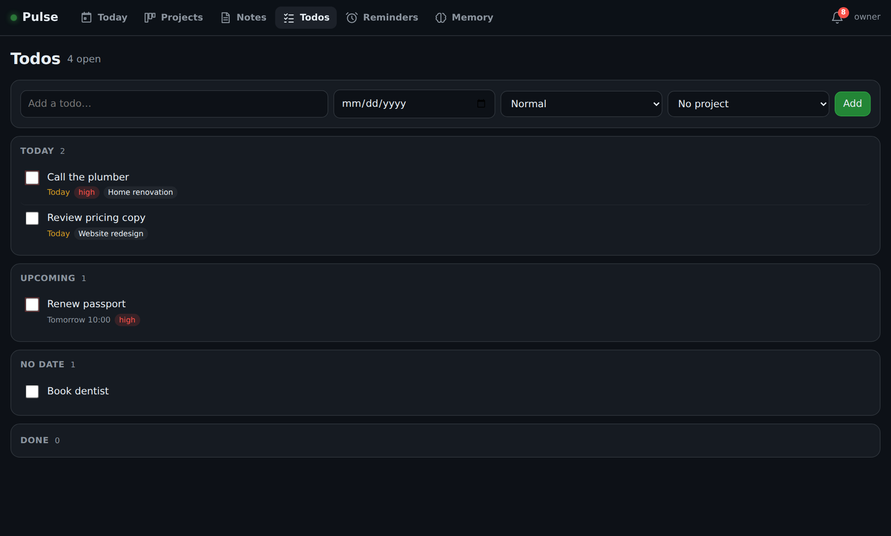
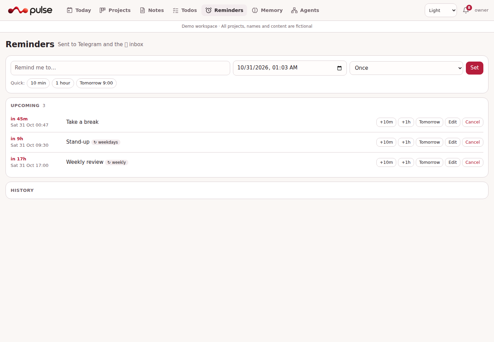
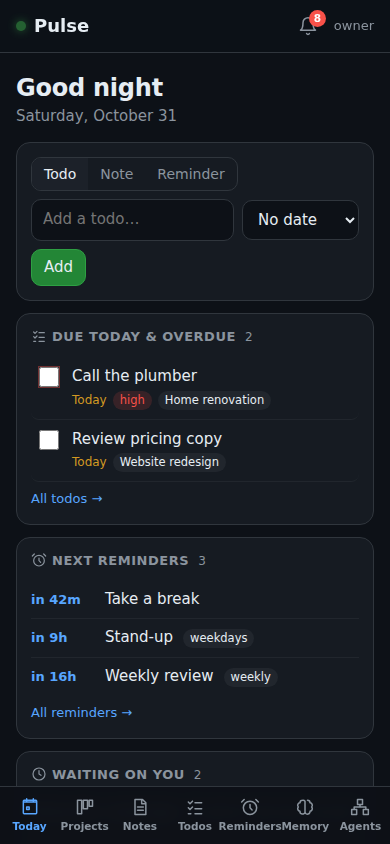
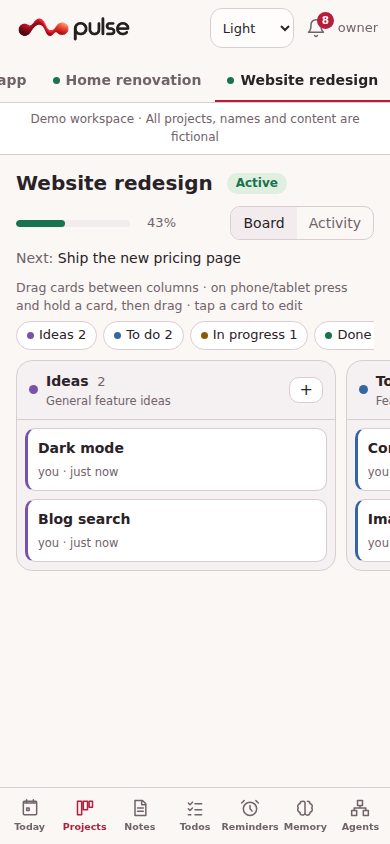

<h1 align="center">Pulse</h1>

<p align="center"><b>Your projects, notes, todos and reminders in one small self-hosted app that your AI agents can use too.</b></p>

<p align="center">
One Python file · Zero dependencies · SQLite · Works on phone, tablet and desktop · MCP server for agents
</p>

<p align="center"></p>

---

## Why Pulse?

Most productivity tools are either too big to self-host or too closed for your AI agents to use.
Pulse is deliberately **simple**:

- **No dependencies.** It runs on the Python standard library and SQLite. No `pip install`, no Node build, no Docker required.
- **One place for everything personal.** Projects, notes, todos, reminders, notifications and long-term memory.
- **Built for agents.** Claude Code, Codex, Cursor and any other MCP client can read and update the same data you see, and every change shows who made it.
- **Yours.** One database on your own server. `python3 backup.py` creates a consistent, validated snapshot while it runs.

## What's inside

| | |
|---|---|
| **Today** | Todos due today, next reminders, things blocked on you, active projects and recent notes. Quick capture at the top. |
| **Projects** | One tab per project with a five-column board: *Ideas → To do → In progress → Done → Blocked*. Drag and drop works on touch screens too. Blocked cards record who must act and why. Optional two-way GitHub issue sync. |
| **Notes** | Markdown, full-text search, tags, pinning, right-to-left text. Optional read-only Markdown copy for Obsidian. |
| **Todos** | Due date and time, priority, project, reminders. Promote a todo to a board card when it becomes real work. |
| **Reminders** | One-off or repeating (daily, weekdays, weekly, monthly) in your timezone, delivered to Telegram. Snooze in one tap. |
| **Inbox** | Every notification Pulse sent: reminders, cards moved to Done or Blocked, messages from agents. |
| **Memory** | Long-term facts your agents remember about people, projects and preferences. You can see and edit all of it. |
| **Privacy** | Mark any note, todo or reminder as *private*: you still see it, agents never do. |

<table><tr>
<td></td>
<td></td>
</tr><tr>
<td></td>
<td></td>
</tr></table>

<p align="center">&nbsp;&nbsp;</p>

## Quick start

You need **Python 3.10 or newer**, with SQLite FTS5 and an IANA timezone database (included in typical Linux installations). No Python packages to install. Release checks target Linux; Windows and macOS are not yet qualified.

```bash
git clone https://github.com/abdarwish23/pulse.git && cd pulse
python3 server.py init      # creates config.json, an agent token and asks for a password
python3 server.py           # http://127.0.0.1:4100
```

Open <http://127.0.0.1:4100>, sign in, done.

**Just looking?** Run `python3 scripts/demo.py` and open <http://127.0.0.1:4101>. It starts with sample data in a temporary folder and leaves your real install alone.

## Connect your AI agents

Pulse includes an MCP server (`pulse_mcp.py`, standard library only). Point your agent at it:

```bash
# Claude Code
claude mcp add -s user pulse -- python3 /path/to/pulse/pulse_mcp.py --agent claude
```

```toml
# Codex: ~/.codex/config.toml
[mcp_servers.pulse]
command = "python3"
args = ["/path/to/pulse/pulse_mcp.py", "--agent", "codex"]
```

The agent then has 31 tools such as `get_today`, `add_todo`, `set_reminder`, `search_notes`, `move_card` and `remember`.
See **[docs/agents.md](docs/agents.md)** for other clients, the full tool list, the CLI, and a short instruction block you can paste into `AGENTS.md` or `CLAUDE.md`.

## Use it from your phone

Pulse listens on `127.0.0.1` by default. To reach it from anywhere, put it behind something that handles HTTPS:

- **Cloudflare Tunnel + Access** (recommended): free, no open ports, email sign-in. Pulse verifies the Access token itself.
- **Tailscale**: private network access from your own devices.
- **Caddy or nginx**: classic reverse proxy with automatic HTTPS. Pulse's password protects it.

Then use your browser's **Add to Home Screen** to get an app icon. Step-by-step guides are in **[docs/deployment.md](docs/deployment.md)**.

## Documentation

| Guide | |
|---|---|
| [Deployment](docs/deployment.md) | systemd service, HTTPS options, backups, updating |
| [Configuration](docs/configuration.md) | every `config.json` option |
| [Agents, MCP and CLI](docs/agents.md) | connect agents, tool reference, CLI |
| [Integrations](docs/integrations.md) | Telegram, GitHub issue sync, Obsidian mirror, external memory |
| [HTTP API](docs/api.md) | REST endpoints |
| [Agent network](docs/agent-network.md) | private agent coordination and shared VPS artifacts |
| [Release checks](docs/release-checks.md) | local verification, upgrade behavior and release gates |

## How it's built

```
server.py        HTTP server, JSON API, SQLite schema and migrations, scheduler, auth
pulse_mcp.py     MCP server (stdio) that calls the API
pulse            command-line client
agent_network.py private agent registry, queue, grants and artifact metadata
network_*.py     outbound connector, clients and WebDAV storage adapter
static/          the web app: plain HTML, CSS and JavaScript, no build step
scripts/demo.py  sample-data demo
tests/           end-to-end tests (python3 -m unittest discover -s tests)
```

The rules that keep Pulse simple: no runtime dependencies, no build step, one database file, and features only when they earn their place.

## Contributing

Issues and pull requests are welcome. Please read [CONTRIBUTING.md](CONTRIBUTING.md) first. It's short.
For security reports, see [SECURITY.md](SECURITY.md).

## License

[MIT](LICENSE)

## Private agent network (opt-in preview)

Connect multiple agents per device, queue requests while devices are offline, and exchange approved files through private Copyparty storage on your VPS. Includes an Agents screen, outbound Linux file connector, CLI and MCP tools. Separately owner-enabled [task workers](docs/task-workers.md) can invoke installed agent runtimes and return their feedback. See [setup, permissions and limits](docs/agent-network.md).
